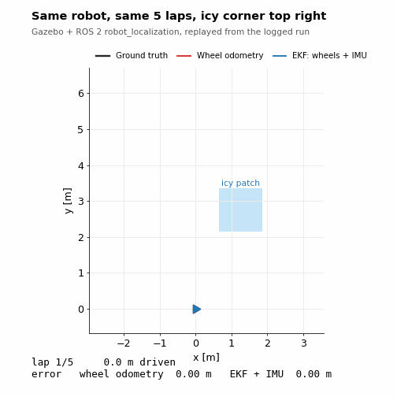
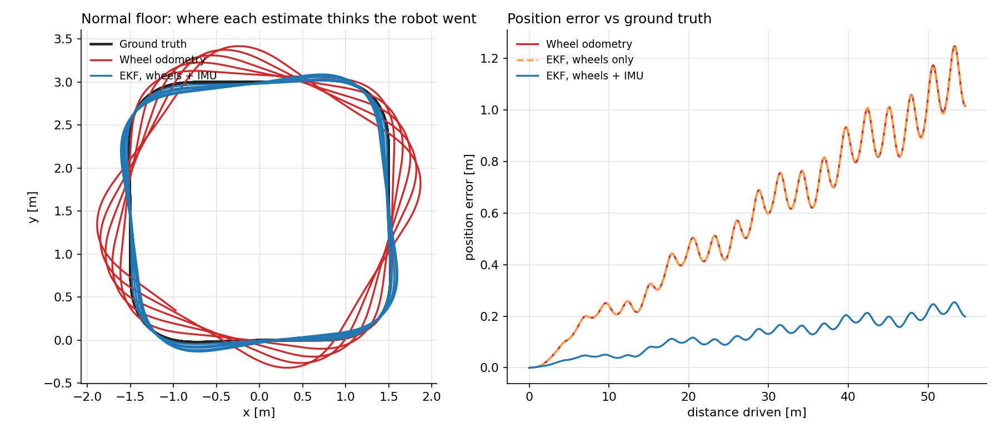
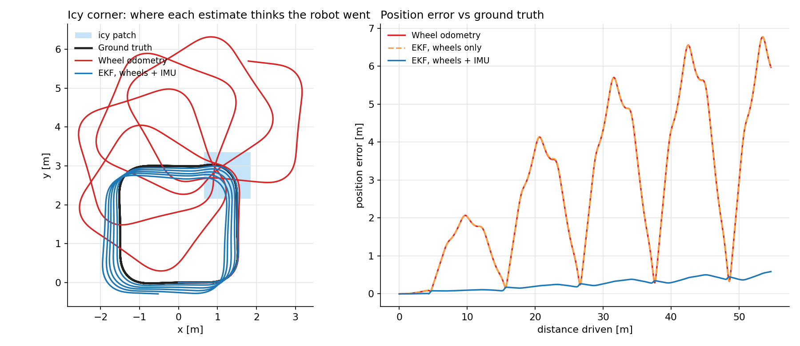
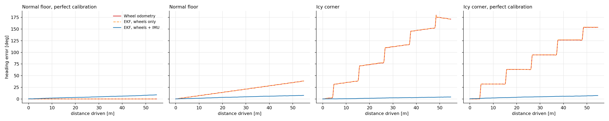
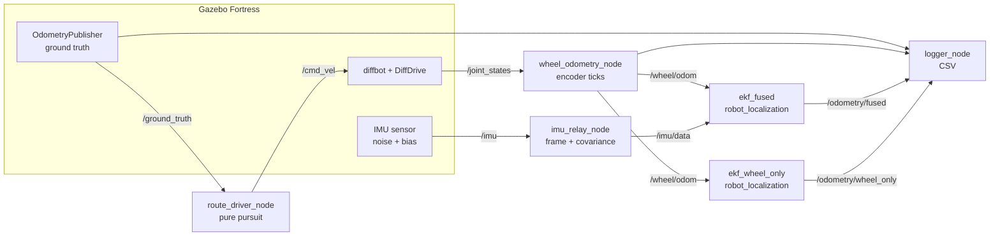

# ros2-ekf-sensor-fusion

Fusing wheel odometry with an IMU gyro using `robot_localization`'s EKF, and checking how much it
actually helps against plain wheel odometry. Same diff-drive robot as my
[MPC project](https://github.com/Shannu2555/ros2-nmpc-diffdrive), now with an IMU, running in
ROS 2 Humble + Gazebo Fortress.



*Replay of a real logged run: black is where the robot actually was (Gazebo ground truth), red is
where its wheel odometry thought it was, blue is the EKF with wheels + IMU. The light blue square
is an icy patch on one corner.*

## Why I did this

In the MPC project the controller got perfect odometry from the simulator, and I said at the end
that I wanted to see what happens with "noisy sensor data instead of perfect odometry". On a real
robot the wheels lie a little all the time (you never know the wheel radius or track width
exactly) and a lot when they slip. The usual fix is to add an IMU and fuse the two with an EKF.
I'd used `robot_localization` before by copying configs. This time I wanted numbers: how wrong is
the odometry, how much does the gyro fix, and what doesn't it fix.

## Results

Each run is 5 laps of a 3 m square with rounded corners (54.7 m, about 3 minutes), steered with
the ground-truth pose so every run drives the exact same path. A fresh Gazebo instance every run.
All numbers come from the CSVs in `results/`, compared against Gazebo's ground truth.

| Run | Estimate | Final position error [m] | RMSE [m] | Final heading error [deg] | Final error / distance |
|---|---|---|---|---|---|
| Normal floor, perfect calibration | Wheel odometry | 0.0001 | 0.0002 | 0.0 | 0.0 % |
| Normal floor, perfect calibration | EKF, wheels + IMU | 0.24 | 0.15 | 8.8 | 0.4 % |
| Normal floor | Wheel odometry | 1.01 | 0.65 | 38.5 | 1.9 % |
| Normal floor | EKF, wheels only | 1.01 | 0.65 | 38.4 | 1.9 % |
| Normal floor | **EKF, wheels + IMU** | **0.20** | **0.14** | **7.6** | **0.4 %** |
| Icy corner | Wheel odometry | 5.97 | 3.40 | 171.3 | 10.9 % |
| Icy corner | EKF, wheels only | 5.97 | 3.40 | 171.2 | 10.9 % |
| Icy corner | **EKF, wheels + IMU** | **0.59** | **0.29** | **4.2** | **1.1 %** |
| Icy corner, perfect calibration | Wheel odometry | 6.41 | 3.39 | 153.6 | 11.7 % |
| Icy corner, perfect calibration | **EKF, wheels + IMU** | **0.65** | **0.31** | **7.3** | **1.2 %** |

Full table with max errors in [`results/metrics.md`](results/metrics.md).

- **Normal floor** = the wheel odometry uses a tape-measure-level calibration: track width 1 % too
  wide, wheel radii 0.1 % apart. With perfect numbers the simulator gives near-perfect odometry
  (first row), which no real robot has, so I put in the kind of error a real one does.
- **Icy corner** = same, plus a 1.2 m patch with friction 0.02 (rubber on ice) on the top-right
  corner, right where the robot turns.

So the gyro cut the final error about 5x on the normal floor and about 10x with the icy corner.
"EKF, wheels only" lands on top of the raw odometry every time, which is the point of running it:
the improvement comes from the gyro, not from putting the data through a Kalman filter.





Things worth saying about these numbers:

- **With perfect wheels, the gyro makes it worse.** First two rows: perfect geometry on a grippy
  floor gives wheel odometry that's right to a fraction of a millimetre, and adding the gyro
  brings in its bias, 0.24 m and 8.8 deg after 5 laps. Fusion only pays off because real wheels
  are never perfect. I almost didn't run this case, and it's the one that taught me the most.
- **Where the odometry goes wrong.** On the normal floor it's a steady curve: the 1 % track error
  makes every turn come out slightly short, and that adds up lap after lap. On the icy corner it's
  a jump of ~30 deg of heading every time the robot crosses the patch. The wheels spin in the turn
  and the encoders count rotation that never happened.
- **What the gyro fixes and what it doesn't.** Heading, almost completely. Distance, no. When
  the wheels spin on the ice they also count distance that wasn't driven, and nothing in this
  setup can see that, so the blue laps creep outward a bit each time round. Fixing that needs a
  sensor that measures position or speed independently (lidar scan matching, visual odometry, GPS
  outside).
- **The leftover heading error is the gyro's own bias.** I gave the simulated gyro the noise of a
  cheap MEMS part (0.009 rad/s noise at 100 Hz) and a small leftover bias after the usual
  "keep still at startup" calibration (0.0005 rad/s, about 0.03 deg/s). Gazebo picks the bias sign
  at random per run, so it shows up as 4-8 deg over 3 minutes in either direction. Without a
  magnetometer or a map the EKF can't see that bias at all.
- **I didn't use the IMU's orientation.** Gazebo gives a perfect absolute orientation, but a
  cheap IMU without a magnetometer can't, so fusing it would have been cheating. Only the gyro's
  yaw rate goes in.
- **Steering with ground truth is on purpose.** If the robot steered with one of the estimates,
  each run would drive a different path and I'd be comparing different things. This way the
  estimators only listen.
- **Simulation only, one run per case.** It's a clean comparison, not a real robot. Real wheels
  also slip on carpet edges, door sills and when accelerating hard.

## Getting there took three attempts

The final config wasn't my first one. All three are kept in `results/`:

| Attempt | Fused EKF config | Floor: final error | Icy corner: final error / heading |
|---|---|---|---|
| 1 | wheels give speed **and** yaw rate, gyro gives yaw rate | 0.14 m | 1.33 m / 22.4 deg |
| 2 | same + `odom0_twist_rejection_threshold: 3.0` | 1.06 m | 0.40 m / 15.5 deg |
| 3 (final) | wheels give **only** speed, gyro gives yaw rate | 0.20 m | 0.59 m / 4.2 deg |

- **Attempt 1** looked fine on the floor, but on the ice the fused heading still stepped up ~3 deg
  every time round (see `results/attempt1_wheel_yaw_rate/heading_error_first_attempt.png`). I'd
  told the filter the wheel yaw rate was much less trustworthy than the gyro, but "much less"
  isn't zero, and a wheel spinning on ice reports yaw rates that are completely wrong.
- **Attempt 2** tried to reject those readings with a 3-sigma Mahalanobis gate. It helped on the
  ice and made the normal floor 7x worse. The gate checks speed and yaw rate together, and every
  time the robot sped up out of a corner the filter's speed estimate lagged behind, so it started
  rejecting perfectly good readings and then drifted.
- **Attempt 3** just doesn't give the filter the wheel yaw rate at all: wheels for speed, gyro for
  turning, which is what each one is good at. The floor result got slightly worse than attempt 1
  (0.14 -> 0.20 m, mostly a different gyro bias draw), the icy corner a lot better.

## How it works



- **Wheel odometry** reads the wheel angles from `/joint_states`, turns them into 2048-count
  encoder ticks and integrates them with the geometry it was given (midpoint integration). Gazebo's
  own diff-drive odometry is switched off, it would just be the commanded speeds.
- **IMU relay.** The bridged IMU message comes with a Gazebo-scoped frame name and zero
  covariance. `robot_localization` reads zero covariance as "perfect sensor", so the relay fills in
  the noise I configured and the `imu_link` frame.
- **Two EKFs on the same data.** `ekf_fused` (wheels + gyro, owns `odom -> base_link`) and
  `ekf_wheel_only` (wheels only, publishes no TF). 2D mode, 50 Hz.
- **Logger** writes ground truth and every estimate with each message's own timestamp, and
  `tools/analyze.py` interpolates everything onto the ground-truth timestamps before comparing,
  so logging delay doesn't count as error.

## Repo layout

```
ekf_fusion/
  wheel_odometry.py       encoder-tick odometry, no ROS imports (tested on its own)
  wheel_odometry_node.py  ROS 2 node around it
  imu_relay_node.py       frame + covariance for the IMU messages
  route.py                rounded-square laps + pure pursuit, no ROS
  route_driver_node.py    drives the laps using ground truth
  logger_node.py          CSV logger, ends the run when the laps are done
  path_viz_node.py        RViz trails (viz:=true only)
config/                   wheel/IMU/driver params, the two EKF configs
launch/sim.launch.py      Gazebo + bridge + robot_state_publisher (+ RViz)
launch/fusion.launch.py   wheel odometry, IMU relay, both EKFs, driver, logger
urdf/                     diffbot with IMU and ground-truth publisher
worlds/                   floor.sdf, slippery.sdf
scripts/                  run_scenario.sh, run_all.sh (headless, what I used)
tools/analyze.py          CSVs -> metrics table + plots
tools/animate.py          CSV -> replay video / GIF
results/                  the CSVs and logs behind every number above
test/                     pytest
```

## Running it

Ubuntu 22.04 + ROS 2 Humble:

```bash
sudo apt install ros-humble-robot-localization ros-humble-ros-gz ros-humble-xacro ros-humble-robot-state-publisher
mkdir -p ~/ws/src && cd ~/ws/src
git clone https://github.com/Shannu2555/ros2-ekf-sensor-fusion.git ekf_fusion
cd ~/ws && colcon build --symlink-install && source install/setup.bash

# terminal 1 (world:=floor or world:=slippery, rviz:=true to watch)
ros2 launch ekf_fusion sim.launch.py world:=slippery rviz:=true
# terminal 2
ros2 launch ekf_fusion fusion.launch.py tag:=slippery calibration:=measured viz:=true out_dir:=$HOME/fusion_logs
```

Restart the sim between runs, the robot has to start from the origin. Or run everything headless,
one fresh Gazebo per case:

```bash
./scripts/run_all.sh ~/fusion_logs
python3 tools/analyze.py ~/fusion_logs ~/fusion_logs/plots
python3 tools/animate.py ~/fusion_logs/slippery.csv slippery.mp4
python3 -m pytest test
```

I ran it on WSL2 (Ubuntu 22.04) on a laptop with an i5-12500H, Gazebo server only.

## What was hard / what broke

- **The odometry was perfect, which was the problem.** My first runs used Gazebo's ideal
  geometry and the wheel odometry came back almost exactly right. That's not a test of anything, so
  I added a realistic calibration error and the icy patch instead of just adding random noise.
- **Before that, it was terrible for the wrong reason.** With cylinder wheel collisions, the
  odometry lost ~35 deg of heading per lap even with perfect geometry. Gazebo's contact model made
  the wheels scrub in every turn. Switching the wheel collision to a sphere (a common trick) fixed it.
- **A 10 cm error that wasn't real.** The wheels sit 8 cm in front of the chassis centre.
  Wheel odometry measures the axle, ground truth was reporting the chassis centre, so every turn
  showed ~10 cm of "error" that was just the lever arm. I moved `base_link` onto the axle (the usual
  ROS convention) so both describe the same point.
- **"Wet tiles" did nothing.** The first icy patch had friction 0.08. At 0.3 m/s the turns need
  almost no grip, so the wheels never slipped. 0.02 did it.
- **The IMU relay crashed on its first message.** ROS 2 message fields are strict about types:
  `[g, 0, 0, ...]` with Python ints isn't a valid `float64[9]`. Took me longer to spot than it should have.
- **Starting together.** The EKFs came up a second after the robot started moving, so they began
  ~7 cm behind. The driver now waits until every estimator is publishing, then 3 s more.
- **Shutdown crash, again.** Same bug as in the MPC project: the driver tried to send a stop command
  after ROS had already shut down. It only happens after the laps are done (you can see it at the end
  of `results/fusion_floor.log`), but it's fixed now.

## Next

Adding a 2D lidar and doing SLAM + Nav2 on the same robot, which is the first thing that can
actually correct the distance error the gyro can't.

## License

MIT
